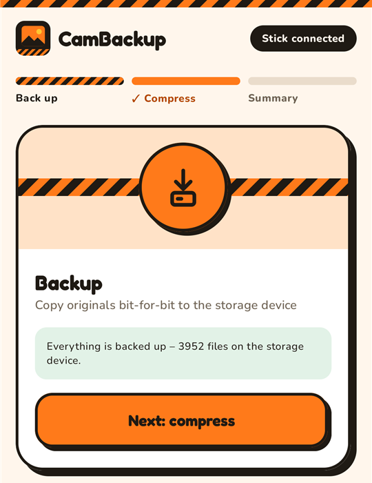
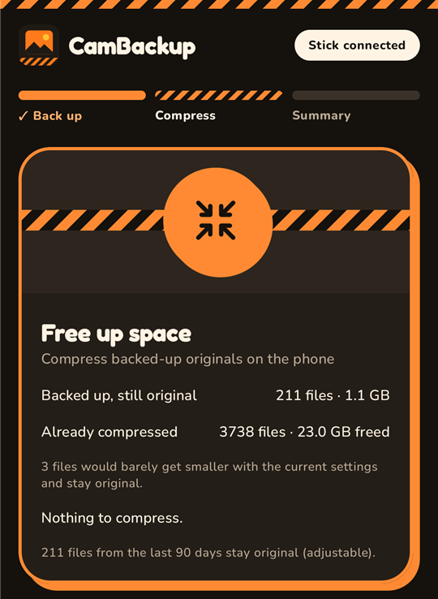
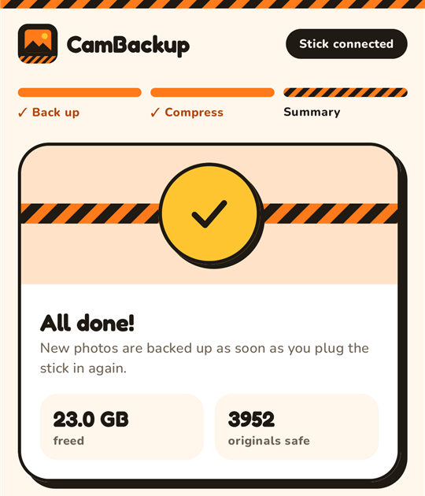
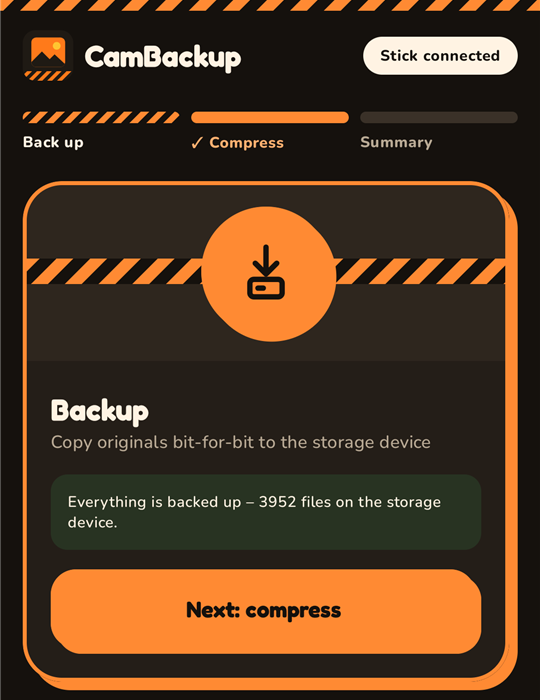
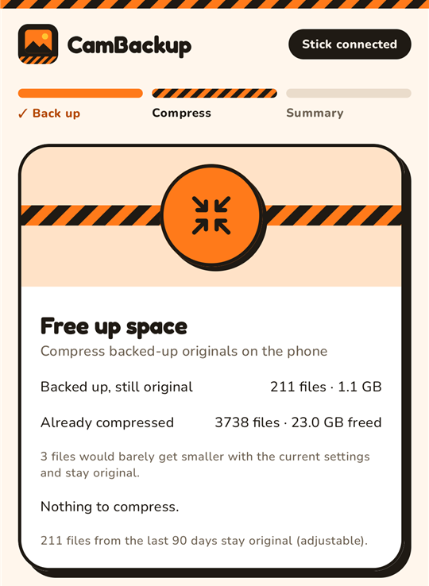
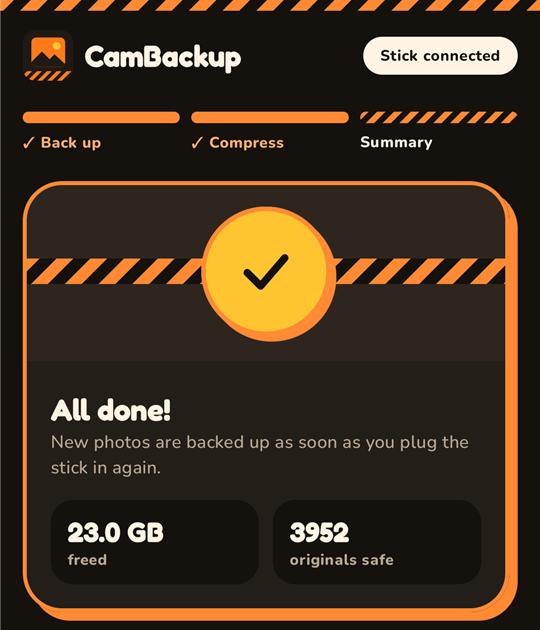
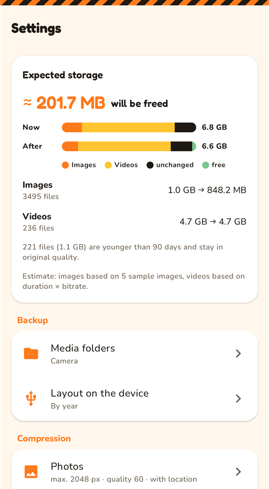
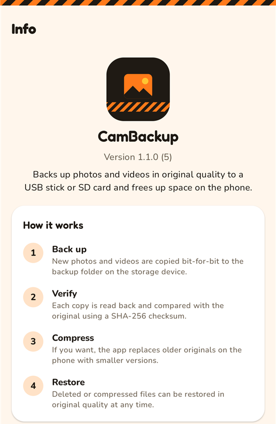

# CamBackup

**Back up your phone's photos and videos bit-for-bit to a USB stick or SD card – then free up space by
replacing the originals on the phone with smaller versions. Only files that are provably backed up are
ever touched.**

<p>
  
  
  
</p>

CamBackup is an Android app (Kotlin, Jetpack Compose) for people who shoot a lot with their phone and
run out of storage, but don't want to hand their pictures to a cloud service. Plug in a stick, back up,
compress – the originals stay safe on the stick and can be restored at any time.

The app has **no internet permission**. Nothing leaves the phone except onto the storage device you
choose.

## How it works

1. **Back up** – new photos and videos from the camera folder are copied to a folder on the USB stick
   or SD card (Storage Access Framework). The phone is recognised again the next time the stick is
   plugged in; only new files are copied.
2. **Verify** – every copy is read back from the stick and compared with the original using SHA-256.
   Only then does a file count as backed up.
3. **Compress** – optionally, older originals (default: older than 90 days) are replaced on the phone
   by smaller versions: JPEGs are re-encoded (max. edge, quality), videos are re-encoded with Media3
   Transformer (H.264/HEVC, resolution, bitrate). Date, orientation and – optionally – location are kept.
4. **Restore** – compressed or deleted files can be restored in original quality from the stick, all at
   once or selected in the built-in gallery.

### Safety rules

- A file on the phone is only replaced if its original is on the stick **and** its SHA-256 still
  matches the backup – checked again immediately before replacing.
- Replacing only happens while the stick is connected. Pulling the stick mid-run cancels cleanly;
  nothing is left half-written.
- A compressed file must pass sanity checks (duration, audio track, resolution) or the original stays.
- Android asks for permission (system dialog) before any file is changed.
- **Dry run** is on by default: the app only calculates how much space would be freed.
- Files that are not worth compressing (too little saving) are remembered and retried only when the
  settings change.

Motion photos are compressed like normal photos – the motion part is dropped on the phone but stays
in the original on the stick.

## Screenshots

| Back up | Compress | Summary |
|---|---|---|
|  |  |  |

| Settings | Info |
|---|---|
|  |  |

## Features

- Bit-exact backup with SHA-256 verification, resumable after interruptions
- Several phones on one stick – each gets its own folder, recognised automatically
- Folder layout on the stick: flat, by year, or by year/month (existing backups are moved when changed)
- Optional additional media folders besides the camera folder
- Compression with live estimate of the space that will be freed, trial compression of single files
- Built-in gallery with backup status per file, in-app video playback, selective restore,
  "never compress" marker
- Handles files deleted on the phone: restore them from the stick or delete them from the backup
- Background work with pause/cancel, progress notification and time estimate
- English and German, light and dark theme

## Data on the storage device

```
<chosen folder>/
├── 2024/                      originals, bit-identical (layout configurable)
├── 2025/
└── Metadata/
    ├── device.json            phone identification (app-generated UUID, model, name)
    ├── backup_index.json      every backed-up file: path, size, SHA-256, status, compression info
    ├── backup_journal.jsonl   append-only changes, merged into the index
    ├── backup_log.txt         human-readable log of all runs
    └── file_list.csv          file list for spreadsheets
```

All files on the stick are written in English so they stay readable regardless of the app language.

## Requirements

- Android 11 (API 30) or newer
- A USB stick / SSD (USB-C or OTG adapter) or SD card – exFAT recommended (FAT32 cannot hold files > 4 GB)

## Building

Requirements: JDK 17 or newer (e.g. the JetBrains Runtime bundled with Android Studio) and the Android SDK.

```sh
./gradlew testDebugUnitTest      # unit tests
./gradlew assembleDebug          # debug APK
```

### Release build

Release signing is read from `keystore.properties` in the project root (not in the repository):

```properties
storeFile=release.jks
storePassword=…
keyAlias=…
keyPassword=…
```

```sh
keytool -genkeypair -v -keystore release.jks -keyalg RSA -keysize 4096 -validity 10000 -alias cambackup
./gradlew assembleRelease
```

Without `keystore.properties` the release build is unsigned.

## Tech stack

Kotlin · Jetpack Compose (Material 3) · MVVM with StateFlow · WorkManager · DataStore ·
Storage Access Framework · MediaStore · AndroidX ExifInterface · Media3 Transformer & ExoPlayer ·
kotlinx.serialization

## License

[MIT](LICENSE). The bundled fonts [Fredoka](https://fonts.google.com/specimen/Fredoka) and
[Nunito](https://fonts.google.com/specimen/Nunito) are licensed under the
[SIL Open Font License 1.1](https://openfontlicense.org).
